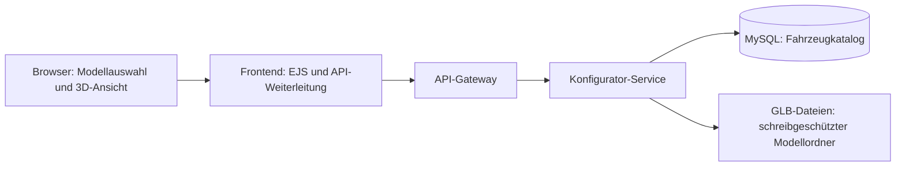

# Car Manufacturer

Cloud-native Microservices Web-App (HHZ Reutlingen, Gruppenprojekt).

## Start

```bash
git clone https://github.com/TobiStudent45/Cloud-based-Web-Application.git
cd Cloud-based-Web-Application
cp .env.example .env
docker compose up --build
```

| Dienst | URL |
|---|---|
| Web-App | http://localhost |
| phpMyAdmin | http://localhost:8081 |
| Redis Commander | http://localhost:8082 |
| MinIO Console | http://localhost:9001 |

Login: `hhzadmin` / `hhzadmin`

## Car-Konfigurator

Unter http://localhost/configurator bietet die Seite Modellauswahl, interaktive
3D-Ansicht (Drehen/Zoomen) und Zurücksetzen der Kamera. Für den Lambo lassen sich
Lackfarbe, Lackoberfläche (glänzend, satiniert, matt), Felgenfarbe und
Bremssattelfarbe direkt am Modell ändern. Im Bereich „Innen“ sind außerdem
Lederflächen, Alcantara und
Sicherheitsgurte konfigurierbar. „Sitze & Details“ und „Cockpit“ bieten zwei
Innenraumansichten. Die Materialstruktur der GLB bleibt erhalten: gemeinsam
verwendete Leder- und Alcantara-Materialien werden jeweils zusammen eingefärbt.
Eine Zusammenfassung zeigt die Auswahl. „Original wiederherstellen“ setzt alle
Materialänderungen zurück. Die Auswahl
bleibt beim Modellwechsel während des Seitenbesuchs erhalten. Die Preisübersicht
zeigt Grundpreis, Extras und Gesamtpreis. „Konfiguration speichern“ speichert den
aktuellen Stand in MySQL; danach sind JSON-Download und ein Link zum erneuten
Öffnen verfügbar. Änderungen nach dem Laden werden mit aktuellen Preisen bewertet.

1. Lege `Lambo.glb` unter `services/configurator/models/Lambo.glb` ab.
2. Das fertige Beetle-Modell liegt unter `services/configurator/models/Beetle-web.glb`.
3. Starte mit `docker compose up --build` und öffne die Konfigurator-Seite.

Ohne GLBs bleibt die Auswahl bedienbar und zeigt einen Hinweis auf fehlende Modelle.
Nach dem Hinzufügen einer Datei genügt es, die Seite neu zu laden. Dateinamen sind
im Linux-Container groß-/kleinschreibungssensitiv. Die GLBs müssen ihre Texturen
selbst enthalten. Die Originalmaterialien lassen sich jederzeit wiederherstellen.

Der Beetle verwendet direkt das fertige Modell `Beetle-web.glb` mit vollständiger
Karosserie, vollständigen Sitzen und vorbereiteten Grundmaterialien. Beim Beetle sind Lack,
Lackoberfläche, Sitzpolster, Sitzakzente, Innenverkleidung und Armaturenbrett
konfigurierbar. Felgen und Stoßfänger teilen sich ein Chrommaterial; deshalb
wird keine separate Felgenfarbe angeboten.



Der Service liefert auch die GLB-Dateien über das Gateway aus; die Darstellung
erfolgt im Browser mit dem lokal ausgelieferten
[model-viewer](https://modelviewer.dev/). Bei komprimierten Modellen können dessen
Decoder zusätzlich eine Internetverbindung benötigen.

Der Service legt die eigene Tabelle `carmanufacturer.configurator_cars` beim Start
mit `db/mysql/configurator.sql` an und ergänzt zwei Starteinträge. Das funktioniert
auch mit einem bereits vorhandenen MySQL-Volume; vorhandene Katalogeinträge werden
nicht überschrieben. Namen, Beschreibungen und GLB-Dateinamen lassen sich über
phpMyAdmin in dieser Tabelle ändern. Erlaubte Dateinamen: Buchstaben, Ziffern,
Bindestriche und Unterstriche, gefolgt von `.glb`.

API (alle Zugriffe über das Gateway):

- `GET /api/configurator/cars`: Fahrzeugkatalog mit Verfügbarkeit der GLBs.
- `GET /api/configurator/cars/:id`: Einzelnes Fahrzeug.
- `GET /api/configurator/cars/:id/options`: Anpassungen, Auswahlwerte und Materialzuordnung.
- `GET /api/configurator/cars/:id/model`: Binäre GLB-Datei, 404 bei fehlendem Modell.
- `POST /api/configurator/quote`: Serverseitige Preisberechnung für `{ "carId": "lambo", "selections": { "paint": "blue" } }`.
- `POST /api/configurator/configurations`: Auswahl und aktuellen Preisstand speichern;
  optional eine UUID als `requestId` für wiederholbare Speicheranfragen.
- `GET /api/configurator/configurations/:id`: Gespeicherte JSON; mit `?download=1` als Datei.
- `/configurator?configuration=:id`: Gespeicherte Auswahl wieder in der 3D-Ansicht öffnen.

Die Tabelle `configurator_option_groups` enthält die modellabhängigen Optionen.
Die Spalte `section` ordnet sie den Bereichen `exterior` und `interior` zu;
bei älteren Datenbankständen ergänzt der Service die Spalte automatisch.
`services/configurator/options.js` liefert die Starteinträge je Fahrzeug;
bestehende Einträge werden beim Neustart nicht überschrieben. Die neue Tabelle
wird auch bei bestehenden MySQL-Volumes automatisch angelegt. Für weitere GLBs
müssen passende Materialnamen und Optionen hinterlegt werden. Gruppen werden nur
angezeigt, wenn ihre Materialien tatsächlich im geladenen Modell vorhanden sind.
Die Steuerung ändert Materialien; alternative Felgengeometrien und zusätzliche
Bauteile sind nicht enthalten.
Der frühere zweite Platzhalter wird beim Start durch den Beetle ersetzt, sofern
er noch unverändert ist. Die entfernte Option `interior-stitching` wird auch aus
bestehenden Datenbanken gelöscht.

### Preise und gespeicherte Konfigurationen

Alle Preise sind **fiktive EUR-Demopreise** für dieses Projekt. Startwerte:
Lambo 285.000 EUR, Beetle 35.000 EUR. Originaloptionen kosten keinen Aufpreis.
`services/configurator/pricing-catalog.js` enthält die Preisvorlage. Der Service
ergänzt nur fehlende Werte; Preisänderungen im laufenden Katalog erfolgen in MySQL.

- `configurator_cars.base_price_cents`: Grundpreis in Cent.
- `configurator_choice_prices`: Aufpreis je Fahrzeug, Optionsgruppe und Auswahl.
- `configurator_configurations`: UUID, Fahrzeug-ID, vollständige JSON, Gesamtpreis
  in Cent und Erstellungszeitpunkt.

Die Tabellen und die neue Grundpreisspalte werden auch bei bestehenden Volumes
automatisch ergänzt. Vorhandene Optionen und bereits eingetragene Preise bleiben
erhalten. Fehlende oder ungültige Preise führen zu einer Fehlermeldung.

Der Browser sendet ausschließlich IDs. Der Service validiert Fahrzeug und Optionen,
liest die Preise aus der Datenbank und rechnet mit ganzzahligen Centbeträgen.
Eine gespeicherte JSON enthält `schemaVersion`, `id`, `createdAt`, `currency`,
`pricingType`, `vehicle`, `selections` und `totals`. Die Auswahl hält IDs,
Bezeichnungen, Aufpreise, Materialnamen und Materialwerte fest. Der historische
Preisstand bleibt auch nach späteren Katalogänderungen erhalten. Beim erneuten
Öffnen werden die Options-IDs mit dem aktuellen Katalog geladen und die aktuellen
Preise angezeigt; die gespeicherte JSON selbst bleibt unverändert.

Weitere Ausstattung und Übergabe an Warenkorb/Bestellungen sind spätere Erweiterungen.
